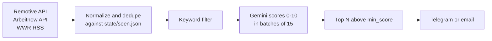

# Job Alert Automation

A script that checks a few public job feeds each morning, asks Gemini how well each posting fits my profile, and sends me the best five.

I'm a student looking for data and AI internships. Reading the same boards every day wastes time, so I wanted something that does the first pass and tells me why a job is or isn't worth opening.

This is the dry run. It uses made-up postings and hand-written scores, so it needs no key and no network:

```text
$ python main.py --dry-run
Job digest 2026-11-15 - 4 match(es)

1. [9/10] Junior Data Analyst - Northwind Example Co (Remote)
   Entry-level data role using SQL and Python, matches the profile.
   https://example.com/jobs/1 (via sample)

2. [8/10] Machine Learning Intern - Example Labs (Brisbane, Australia)
   ML internship in Python, good fit and nearby.
   https://example.com/jobs/2 (via sample)

3. [8/10] Data Engineering Intern - Sample Analytics Ltd (Remote)
   Data engineering internship, no experience needed.
   https://example.com/jobs/3 (via sample)

4. [7/10] AI Research Assistant - Fictional Institute (Remote)
   AI research support, part-time, fits a student.
   https://example.com/jobs/6 (via sample)
```

## Quick start

```bash
pip install -r requirements.txt
python main.py --dry-run
cp .env.example .env.local    # then fill in the keys, see below
python main.py                # live fetch and scoring, prints only
python main.py --send         # same, and sends to Telegram or email
```

## How it works



There are two versions of the same flow. The Python one (`main.py`) runs on a GitHub Actions cron and needs no server. The n8n one (`n8n/job-alert.workflow.json`) shows the same steps as nodes. I only checked that the n8n file imports. I have not run it end to end in n8n.

## How AI helped

Gemini scores each posting against `profile.json` and gives a one-line reason. An AI coding assistant helped me write the code and tests. I read the sources' terms and checked the output myself.

## Setup

1. Install Python 3.12 and run `pip install -r requirements.txt`.
2. Run `python main.py --dry-run` to see the demo.
3. Edit `profile.json`. Fill in `candidate.summary`, roles, skills and keywords. A live run refuses to start while the summary still says "EDIT ME".
4. Get a Gemini key at https://aistudio.google.com/apikey.
5. Copy `.env.example` to `.env.local` and fill in `GEMINI_API_KEY` and `GEMINI_MODEL`. The model name in the example is unverified, so use one your key can call.
6. Make a Telegram bot with @BotFather, message it once, and put the token and your chat id in `.env.local`. Email over SMTP also works.
7. Run `python main.py`. It fetches, scores and prints, and sends nothing.
8. Run `python main.py --send` to send. While testing, point the chat id at a private chat.
9. For the daily schedule, push to GitHub and add the secrets `GEMINI_API_KEY`, `TELEGRAM_BOT_TOKEN` and `TELEGRAM_CHAT_ID`, plus the variable `GEMINI_MODEL`. `.github/workflows/daily.yml` then runs every day, and the Run workflow button lets you test it.
10. To use n8n instead, import the workflow JSON, create the credentials "Gemini API key" (Header Auth, name `x-goog-api-key`) and "Telegram bot", set your chat id in the last node, edit the profile in the "Normalize and dedupe" node, and activate it.

Tests run with `python -m unittest discover -s tests`. The `tests` workflow in GitHub Actions runs the same command on every push.

## Sources

- Remotive public API (https://remotive.com/api/remote-jobs). Their terms say to link back to the posting, not repost it, and not call the API more than a few times a day. The digest links to the original page and goes only to me.
- Arbeitnow public API (https://www.arbeitnow.com/api/job-board-api). I read their robots.txt when I added it and it allowed this. I haven't re-checked since.
- We Work Remotely RSS (https://weworkremotely.com/remote-jobs.rss). Same robots.txt note. The n8n version leaves this feed out.
- Not used: LinkedIn, anything behind a login, anything that blocks bots.

To add a source, write a fetcher in `sources.py` and add an entry to `profile.json`. Read the site's robots.txt and terms first.

## What went wrong along the way

- The keyword filter matched "AI" inside "email" and let nearly everything through. It now matches whole words, which is also why "internship" is its own keyword.
- The Windows console crashed on an en dash in a company name. `main.py` now forces UTF-8 output.
- The first We Work Remotely URL returned an empty page. I switched to their main feed.
- Docker was installed but its engine wasn't running, so I installed n8n with npm.

## Limits

- I have not made a live Gemini call or a real Telegram or email send yet, because I haven't set up the key and bot. The tests cover the parts around them with fakes.
- The Actions schedule has not run yet either.
- The scores in the dry run are values I wrote by hand, and the postings are made up.
- The default model `gemini-2.5-flash` is unverified against my key. The Gemini docs I read list it as a stable model, but newer Flash models exist and names change. If a call fails with a 404, set `GEMINI_MODEL` to a current one.
- Scores are only as good as the profile text and the first 600 characters of each posting.
- n8n remembers seen postings only while the workflow is active. The Python version keeps them in `state/seen.json` and the Action commits that file back.

## Licence

MIT
