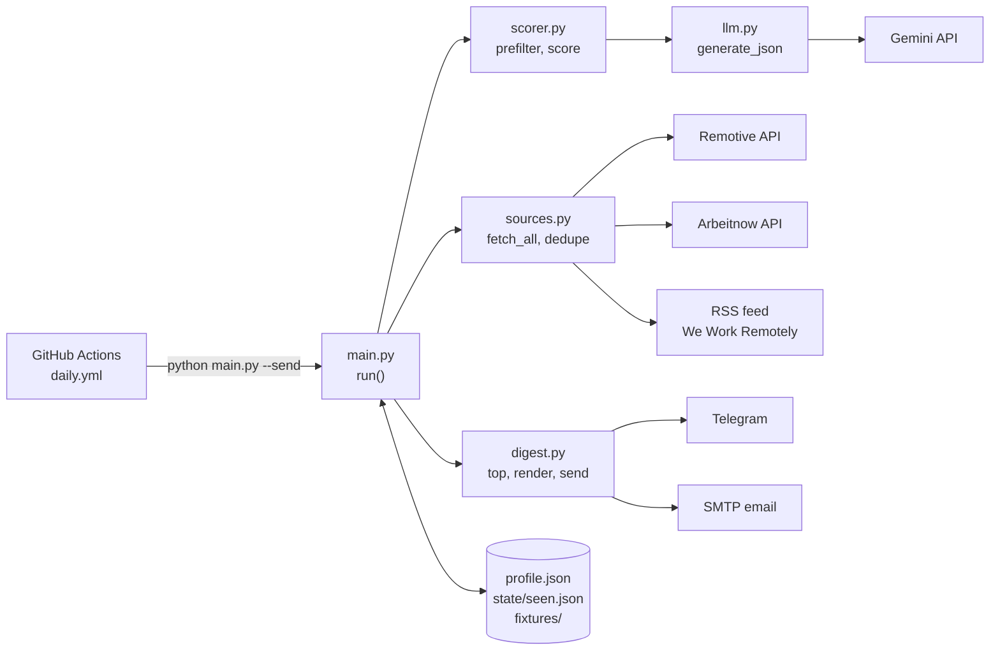

# Components

Modules of the Python version and the outside systems they call.

Sources: [main.py](../../main.py), [sources.py](../../sources.py), [scorer.py](../../scorer.py), [llm.py](../../llm.py), [digest.py](../../digest.py), [daily.yml](../../.github/workflows/daily.yml)
